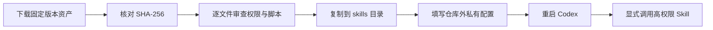

# 中文 Codex Skills

这是一个中文优先、可审计、分批发布的 Codex Skill 仓库。仓库同时保留低风险研究能力和经安全整改的个人工作流／高权限本机自动化；高权限不等于被删掉，而是必须显式调用、参数化配置并在动作前守住授权边界。

> English: A Chinese-first collection of auditable Codex Skills. Research Skills ship in v0.1.0; configurable personal workflows and high-permission local automation ship in v0.2.0 with explicit invocation and documented permission boundaries.

## 发布批次

- **v0.1.0（23 个）**：学术检索、证据核验、文献管理、研究设计、因果推断、元分析、定性研究、科研伦理、可复现性、论文阅读／翻译／写作、基金申请和商品调研。
- **v0.2.0（15 个）**：输出副本整理、长对话交接、多账号接力、跨设备同步、Windows UI／桌面／存储维护、公开数据与媒体获取、FramePack、本地视频资料库、Codex 任务改名和本地微信只读工作流。

完整名称、权限、依赖、调用策略、许可证、版本和单 Skill ZIP 哈希见 [`catalog.json`](catalog.json)。

## 下载与安装

推荐从 [GitHub Releases](https://github.com/ranveerankhira-gif/codex-skills-zh/releases) 下载固定版本资产和 `SHA256SUMS.txt`，不要长期依赖会移动的分支 ZIP。

### 单个 Skill

1. 下载 `<skill-name>-<version>.zip` 并核对 SHA-256。
2. 解压后确认顶层只有同名 Skill 目录，先阅读 `SKILL.md`、`agents/openai.yaml`、脚本和权限说明。
3. 三个本机 Codex 共用时，复制完整目录到：

   ```text
   C:\Users\<你的用户名>\.agents\skills\<skill-name>
   ```

   单实例也可放到 `%CODEX_HOME%\skills\<skill-name>` 或 `%USERPROFILE%\.codex\skills\<skill-name>`。
4. 如目标已存在，先逐文件比较；不要静默覆盖。
5. 重启 Codex 后用 `$skill-name` 显式调用高权限 Skill。

### 整包

下载 `codex-skills-zh-v0.1.0.zip` 或 `codex-skills-zh-v0.2.0.zip`，核对同一 Release 中的哈希文件，再按需复制其中的 Skill。真实配置、账号表、浏览器资料、模型和数据不包含在压缩包内。



## 安全原则

- 高权限 Skill 均设置 `allow_implicit_invocation: false`。
- 安装不授权上传、发布、删除、付费、账号变更、桌面控制、模型下载或 GPU 生成。
- 真实绝对路径通过参数或环境变量提供；示例配置不得改成真实值后提交。
- 对话和微信工作流不包含聊天、密钥、登录态、诊断日志或个人配置。
- 递归删除只允许带所有权标记且位于受控临时根目录内的暂存树。
- Base64 仅用于受 MIME 白名单和大小上限约束的内嵌图片。
- 静态扫描、单元测试和哈希复核是门禁，不代替人工验收。

## 许可证与来源

仓库原创内容使用 [MIT License](LICENSE)。改编 Skill 在自己的目录中保留上游许可证与来源说明；单个 Skill 的许可证状态以 `catalog.json` 和该目录文件为准。

## 开发与验证

```powershell
python -X utf8 scripts/build_catalog.py
python -X utf8 scripts/validate_repo.py
python -X utf8 scripts/package_release.py --release all
```

私有 denylist 应通过 `PUBLICATION_DENYLIST_FILE` 指向仓库外文本文件，一行一个禁用字符串；denylist 本身不得提交。

